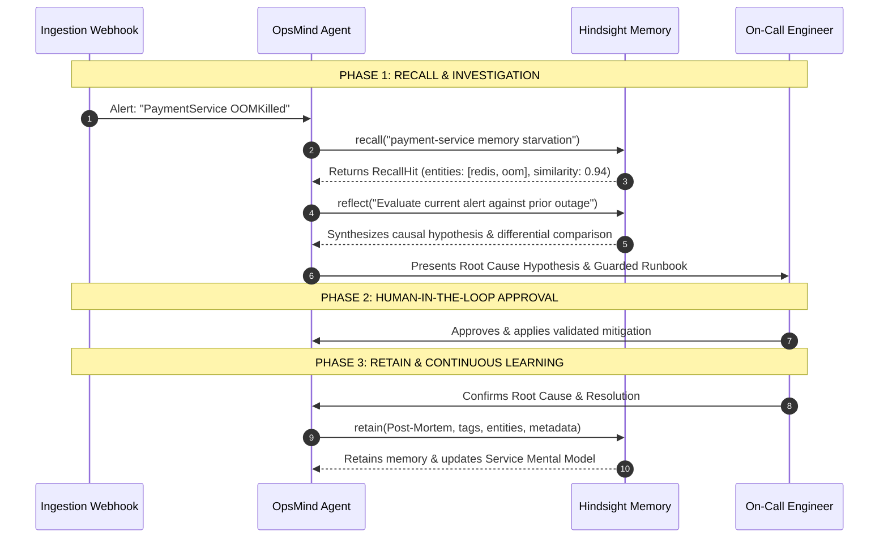

# Vectorize Hindsight Integration in OpsMind

## Why Traditional RAG Fails in Site Reliability Engineering
Standard Retrieval-Augmented Generation (RAG) approaches treat context as static text chunks. In SRE and DevOps operations, naive RAG falls apart:
1. **No Temporal Dimension**: Vector similarity does not know if an alert happened 5 minutes after a code deploy or 6 months ago on a decommissioned version.
2. **Missing Causal Graph Structure**: A latency spike in Service A is often caused by connection pool starvation in Service B. Standard embedding similarity cannot trace topological causal graphs.
3. **No Continuous Learning**: Once an on-call engineer fixes a novel outage at 3 AM, a stateless LLM chatbot forgets the resolution by morning.

---

## The Four Hindsight Primitives in OpsMind



### 1. `retain()`: Structured Memory Encoding
When an incident is resolved, OpsMind invokes `hindsight_service.retain()`:
```python
memory_id = hindsight_service.retain(
    bank_id="opsmind-incidents",
    content=post_mortem_text,
    tags=["payment-service", "redis", "p1", "oom", "verified-fix"],
    metadata={
        "incident_id": incident.id,
        "service": incident.service,
        "root_cause": confirmed_root_cause,
        "resolution": resolution_summary
    }
)
```
Hindsight extracts typed facts, resolves entities, and attaches temporal timestamps.

### 2. `recall()`: Multi-Strategy Parallel Search
When an alert triggers, OpsMind invokes `hindsight_service.recall()`:
```python
hits = hindsight_service.recall(
    bank_id="opsmind-incidents",
    query="payment-service OOMKilled Redis thread starvation",
    top_k=3
)
```
Hindsight performs parallel semantic vector search, BM25 exact keyword matching, and knowledge graph traversal, returning scored hits with extracted entity bindings.

### 3. `reflect()`: Autonomous Causal Reasoning
OpsMind calls `hindsight_service.reflect()` to evaluate raw evidence:
```python
reflection = hindsight_service.reflect(
    bank_id="opsmind-incidents",
    query="Compare current payment-service alarm with previous Redis issue"
)
```
This triggers an agentic reasoning loop that compares the active alert's stack traces against historical precedents, filtering out noise and producing a verified causal hypothesis.

### 4. Living Mental Models
OpsMind maintains pre-computed, standing mental models for all services. These mental models represent the accumulated operational knowledge of a service's reliability profile:
- Recurring failure modes.
- Deployment sensitivities.
- Proven mitigations and baseline limits.
As new incidents are resolved and retained, Hindsight refreshes these mental models in the background.

